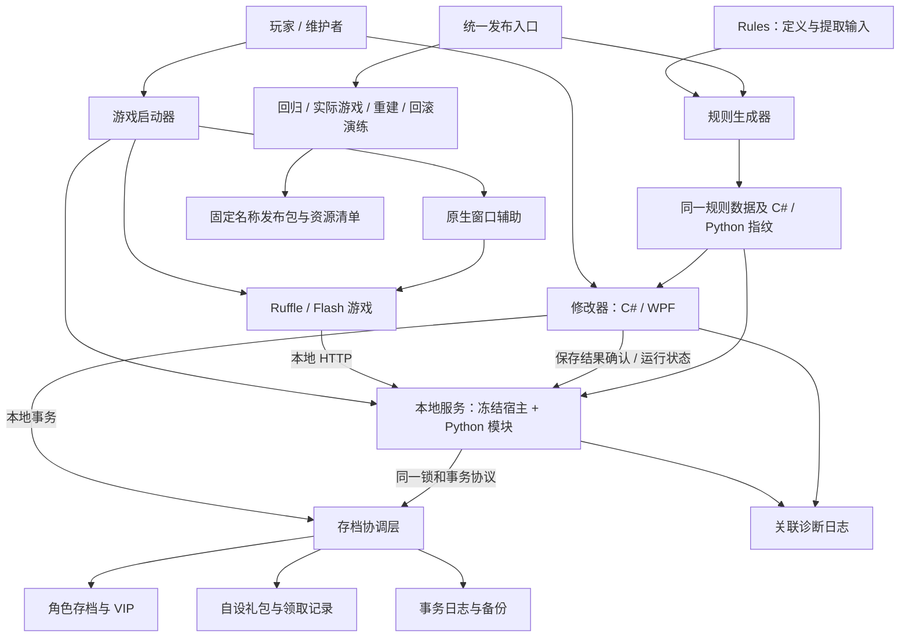
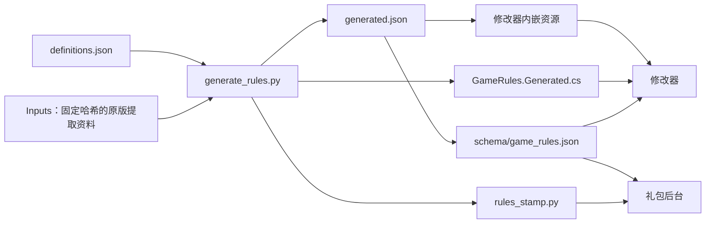
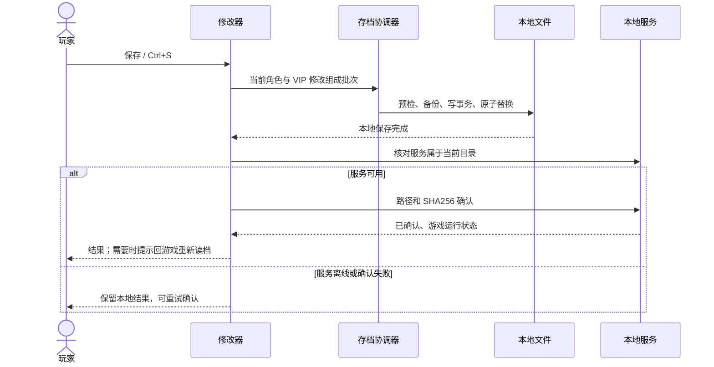

# 造梦西游 3 · 修改器：架构清单

> 技术基线：2.34.0。规则版本：38.7-r1。整理日期：2026-11-14。本文描述已经核对的本地实现；公开仓库内容、实际 GitHub Release 和素材授权状态须分别确认。
>
> 项目定位：非官方、非商业的游戏爱好者维护项目。非商业许可仅覆盖有权许可的新增原创部分，原作、第三方组件及来源未确认内容的范围见 [THIRD_PARTY.md](THIRD_PARTY.md)。

## 目录

- [1. 系统边界](#scope)
- [2. 技术栈与运行进程](#stack)
- [3. 架构总览](#overview)
- [4. 源码目录](#source-tree)
- [5. 安装目录与数据归属](#runtime-tree)
- [6. 模块职责](#modules)
- [7. 统一规则](#rules)
- [8. 存档事务](#storage)
- [9. 保存与游戏同步](#save-flow)
- [10. 本地礼包](#gifts)
- [11. 本地 HTTP 接口](#api)
- [12. 运行状态与日志](#diagnostics)
- [13. 资源版本与缓存](#resources)
- [14. 游戏补丁与窗口](#patches)
- [15. 构建与发布](#release)
- [16. 验证矩阵](#verification)
- [17. 配置、隐私与公开范围](#publication)
- [18. 设计决策](#decisions)
- [19. 已知边界与后续优化](#roadmap)
- [20. 开发变更清单](#change-guide)

<a id="scope"></a>
## 1. 系统边界

本项目维护配套单机环境中的修改器、存档读写、离线礼包、诊断、资源版本及发布流程。核心目标是让本地数据修改可理解、可验证、可恢复。

### 1.1 已有能力

| 领域 | 已有能力 | 重要约束 |
| --- | --- | --- |
| 角色 | 角色形象、属性、背包、穿戴、物品详情 | 角色与背包共用导航；宠物装备在宠物页管理 |
| 图鉴 | 离线物品查询、分类、品质、角色、关键词、分页 | 查询角色不切换当前编辑角色 |
| 宠物 | 新增、成长、技能、装备、出战、休息、放生 | 1 级满成长从第一形态开始且不学技能；极品预设走最终形态与对应装备规则 |
| 技能 | 主动、心法、被动及悬浮说明 | 展示与约束使用配套规则；不虚构固定技能收益 |
| 药园 | 九块地、种植、品级、开垦、翻新 | 药园与土地庙经验相互独立 |
| 增益 | 原版类型、时长、单项编辑与移除 | 修改一项不丢弃其他历史记录 |
| 会员与点券 | 本地 VIP、点券数值、符合条件的礼包发放 | VIP 只升级；没有真实支付、官方充值或平台结算 |
| 活动礼包 | 海报目录、本地码选择、奖励预览、领取反馈 | 本地兑换不代表官方平台码有效；领取记录按存档身份防重 |
| 高级工具 | 原始 JSON、游戏日志、资源版本 | 常用页面只保留一个保存入口 |
| 发布维护 | 规则生成、测试、打包、安装、校验 | 固定启动名与快捷方式；不向正式目录部署测试存档 |

### 1.2 不属于当前系统的能力

- 官方账号、网络支付、官方礼包码验证和运营平台服务。
- 公网多人服务、权限系统、在线反作弊或经济系统。
- 原作游戏全部源码的独立重建。
- 对游戏素材、商标、原版程序的重新授权。
- 把原游戏内部所有表都替换成外部 JSON：统一规则解决的是维护工具与礼包后台的读取来源，Flash 本体仍使用配套版本的内部实现。

<a id="stack"></a>
## 2. 技术栈与运行进程

| 层 | 当前技术 | 作用 |
| --- | --- | --- |
| 桌面修改器 | C# / WPF / .NET 8，Windows x64 | 页面、编辑模型、校验、保存、偏好与说明书 |
| 本地服务 | 配套 Python 3.8 冻结宿主及外置 Python 模块 | 游戏接口、事务协调、礼包、状态和日志 |
| 构建工具 | Python 3.10+、PowerShell 7、.NET 8 SDK | 生成规则、执行回归、组装发布与安装 |
| 游戏运行时 | Ruffle，外部 Rust 项目 | 执行配套 Flash/SWF；保留其独立许可 |
| 游戏补丁 | ActionScript 3、SWF/AVM2 补丁脚本 | 活动页、提示框、身份与旧接口适配 |
| 窗口辅助 | 原生 C / Win32 | 指定窗口的宽高比例、DPI 和尺寸处理 |
| 持久化 | JSON、文件锁、事务日志、原字节备份 | 没有引入数据库 |
| 说明资料 | Markdown、本地 HTML | 离线文档与日志页面 |

### 2.1 进程职责

| 程序 | 是否常驻 | 职责 |
| --- | --- | --- |
| `启动游戏.exe` | 启动协调，生命周期取决于宿主 | 检查资源、准备本地服务、构造运行参数、启动游戏与窗口辅助 |
| `tools/zm3server.exe` | 服务存活期间 | 提供本地 HTTP 接口，加载 `tools/*.py` 维护模块 |
| `runtime/ruffle.exe` | 游戏窗口存活期间 | 真正执行游戏；其存活与后台服务存活分开检测 |
| `runtime/window-helper.exe` | 附着辅助阶段 | 找到指定 Ruffle 窗口，安装线程定向的 Win32 钩子 |
| `runtime/window-aspect.dll` | 附着到目标窗口所在进程后 | 窗口子类化，处理尺寸和 DPI 消息 |
| `修改器/启动修改器.exe` | 修改器窗口存活期间 | 独立编辑本地数据，通过相同事务协议与后台协作 |

冻结宿主可能表现为父、子两个同名系统进程。维护和重启应核对完整可执行路径，不能按进程名批量终止其他安装目录。

<a id="overview"></a>
## 3. 架构总览



### 3.1 当前代码组织方式

桌面端以 `MainWindow` 分部类、专用编辑窗口、领域辅助类和可编辑文件模型组织。它不是完整的 MVVM、微服务或依赖注入架构；不要用尚未落地的架构名称描述当前实现。

本地服务通过 `attach()` 包装已有 HTTP handler，在保留旧接口的基础上接入存档、礼包、诊断及版本能力。外置模块与配套冻结宿主共同构成可运行服务，不是任意 Python 环境下直接执行某一个文件即可替代整个服务。

<a id="source-tree"></a>
## 4. 源码目录

以下路径以当前维护源码目录为根。建议 GitHub 仓库采用这个源码根的相对结构；不要上传包含工作记录、临时崩溃文件和私人数据的整个工作区。

```text
repository/
├─ GmStudio.csproj                 # WPF 项目，固定程序集名
├─ App.xaml / App.xaml.cs          # 应用入口、偏好加载
├─ MainWindow.xaml                # 主窗口
├─ MainWindow.*.cs                # 按页面与流程拆分的窗口逻辑
├─ GameData.cs                    # 目录、存档模型、物品模型与清单
├─ StorageTransaction.cs          # C# 事务协议
├─ GameRules.cs                   # 统一规则读取与校验
├─ GameRules.Generated.cs         # 生成的规则摘要
├─ Pet*.cs / Role*.cs / Vip*.cs    # 领域逻辑与编辑窗口
├─ *Window.xaml                   # 专用编辑、偏好、说明书和诊断窗口
├─ Theme.xaml                     # 统一样式
├─ Rules/
│  ├─ definitions.json            # 规则编辑入口与来源声明
│  ├─ Inputs/                     # 固定哈希的提取资料，公开前审查权属
│  ├─ generated.json              # 生成结果，不手工编辑
│  └─ README.md
├─ Build/
│  ├─ release.json                # 版本、配套二进制、补丁来源声明
│  ├─ release.py                  # 全流程编排
│  ├─ generate_rules.py           # 确定性规则生成
│  ├─ package.py                  # 资源清单、源码包与安装计划
│  ├─ install.ps1                 # 正式安装与异常回滚
│  ├─ clear_output.ps1            # 有归属标记的输出清理
│  ├─ compile38.ps1               # 配套解释器调用
│  ├─ archive_io.py               # 冻结程序归档解析
│  ├─ build_fixture.py            # 重建隔离测试游戏
│  ├─ runtime/                    # 当前后台维护代码的唯一编辑入口
│  ├─ tests/                      # 单元与集成测试
│  └─ README.md
├─ GamePatch/                     # 各轮补丁及历史构建证据声明
├─ Assets/                        # 包含游戏衍生图片，不能默认公开授权
├─ 资源引用.json                   # 配套素材的路径与哈希
├─ 恢复资源.py                     # 校验并还原源码所需图片
└─ release.ps1                    # 对维护者提供的统一入口
```

`GamePatch/StorageRuntime`、`GamePatch/GiftGallery`、`GamePatch/ResourceLayout` 中存在后台模块兼容副本。它们由发布入口同步，当前唯一编辑入口是 `Build/runtime`；不能把这些副本当成独立维护分支。

文件级目录、大小、摘要及公开建议另见 [SOURCE_INVENTORY.json](SOURCE_INVENTORY.json)。它是架构索引，不是著作权鉴定或分发授权证明。

<a id="runtime-tree"></a>
## 5. 安装目录与数据归属

```text
<GAME_ROOT>/
├─ 启动游戏.exe
├─ 启动修改器.lnk
├─ 设置.ini
├─ 使用说明.md
├─ 修改器/
│  ├─ 启动修改器.exe
│  ├─ 修改器-源码.zip
│  └─ 修改器-预览.png
├─ game/                          # 配套游戏资源
├─ runtime/                       # Ruffle 与窗口辅助
├─ icons/                         # 图鉴、宠物、技能、海报等素材
├─ schema/
│  ├─ game_rules.json             # 统一规则部署文件
│  ├─ resource_manifest.json      # 资源版本与哈希
│  ├─ layout.json                 # 文件布局版本
│  ├─ local_gift_catalog.json     # 只读礼包目录
│  └─ ...                         # 兼容资料与图标映射
├─ tools/
│  ├─ zm3server.exe
│  ├─ *.py / game_log.html
│  ├─ cmd.txt                     # 旧内部通信文件
│  ├─ local_gifts.lock            # 公共字节锁
│  └─ local_gifts.transaction.json # 仅在事务待处理时存在
├─ saves/
│  ├─ slot0.json ... slot5.json
│  ├─ vip.json
│  ├─ gifts/local_gifts.json      # 用户定义与领取记录
│  ├─ backups/
│  └─ .gm-backups/
├─ rundata/
│  ├─ SharedObjects/
│  ├─ config/
│  └─ cache/<buildId>/
├─ logs/
├─ backup/game/                   # 关键资源恢复基线，不是完整游戏备份
├─ 资料/
├─ manifest.sha256
└─ manifest.sha512
```

| 分类 | 内容 | 更新策略 |
| --- | --- | --- |
| 用户进度 | `saves/slot*.json`、`vip.json`、SharedObjects | 保留；禁止测试数据覆盖 |
| 用户礼包数据 | `saves/gifts/local_gifts.json` | 保留定义、额外字段、领取记录与存档身份 |
| 偏好 | `设置.ini`、用户配置目录下的修改器偏好 | 保留；当前用户配置位于 `%LOCALAPPDATA%/Zm3GmStudio` |
| 程序与只读资料 | 修改器、后台模块、规则、资源清单 | 同批构建、核对版本后替换 |
| 可再生内容 | 日志、HTTP 缓存、构建输出 | 按规则管理；不得误删 SharedObjects |
| 恢复材料 | 存档备份、事务日志、关键游戏基线 | 用户备份保留；待恢复事务不能当临时垃圾删除 |

`修改器` 目录只保留固定三个最新版文件。版本写入程序元数据和清单，不写入启动文件名。

<a id="modules"></a>
## 6. 模块职责

### 6.1 桌面端

| 代码入口 | 职责 |
| --- | --- |
| `App.xaml.cs` | 初始化主题、字体偏好、定位游戏目录；QA 入口仅在对应构建中启用 |
| `MainWindow.xaml.cs` | 当前目录、槽位、角色、忙碌及未保存状态 |
| `MainWindow.Save.cs` | 唯一保存流程、服务确认、失败提示与重试状态 |
| `MainWindow.Runtime.cs` | 每 5 秒更新运行状态，防止重复检测 |
| `MainWindow.RoleLayout.cs` / `RoleProfile.cs` | 角色与背包布局、属性与装备预览 |
| `MainWindow.CatalogPager.cs` | 图鉴筛选、整体排序、页码及列表容量 |
| `MainWindow.Pets.cs` | 当前宠物、属性、培养、装备、删除与放生入口 |
| `PetData.cs` / `PetRules.cs` / `PetProfile.cs` | 序列化、成长约束、技能条件、属性计算与极品预设 |
| `PetCreateWindow.*` / `PetEditorWindow.*` | 新增宠物与分范围编辑 |
| `GardenData.cs` / `GardenPlotWindow.*` | 地块、品级、药园与土地庙规则 |
| `AdvancedData.cs` | 技能、增益、装备字段与数值处理 |
| `VipData.cs` / `VipRechargeWindow.*` | 本地 VIP、点券预览和符合条件的礼包发放 |
| `LocalGiftData.cs` / `LocalGiftWindow.*` | 用户本地码、奖励配置、并发冲突和领取记录展示 |
| `GameData.cs` | `GameFolder`、`EditableFile`、`Inventory`、目录与文件读写模型 |
| `GamePaths.cs` | 文件布局选择、根目录边界及新旧路径兼容 |
| `GameRules.cs` | 内嵌规则与外部规则摘要一致性 |
| `StorageTransaction.cs` | 公共锁、冲突预检、备份、事务决定与恢复 |
| `DiagnosticsLog.cs` | 与后台格式一致的关联日志 |
| `ResourceVersionWindow.*` | 离线校验版本、资源及规则指纹 |
| `SettingsWindow.*` / 偏好类 | 字体、栏目和游戏目录统一设置 |
| `HelpWindow.*` / `MarkdownGuide.cs` | 离线 Markdown 及旧包 TXT 兼容阅读 |
| `*Artwork.cs` / `SwfTags.cs` | 图标、头像、SWF 素材读取与缓存 |

### 6.2 当前后台维护模块

| `Build/runtime` 文件 | 职责 |
| --- | --- |
| `local_gifts.py` | 本地礼包定义、预览、领取、身份、防重、容量及回执 |
| `storage_tx.py` | 统一文件锁与事务协议 |
| `runtime_state.py` | 当前目录的进程识别、服务/游戏会话与日志上下文 |
| `runtime_integration.py` | 接入旧 handler，统一存档接口、确认与状态接口 |
| `game_paths.py` | 新旧布局路径选择及根目录边界 |
| `game_rules.py` | 加载部署规则，拒绝缺失或不匹配版本 |
| `rules_stamp.py` | 自动生成的期望规则 SHA256 |
| `resource_versions.py` | 资源索引、HTTP 校验、版本化 URL、缓存目录 |
| `game_log.html` | 本地实时日志阅读界面 |

<a id="rules"></a>
## 7. 统一规则



### 7.1 规则内容

| 分区 | 内容 |
| --- | --- |
| `inventory` | 普通及扩展背包、宠物栏、宠物装备、叠加和批次数量 |
| `pet` | 资质、成长、潜力、技能、专属精灵奥义、别名与预览曲线 |
| `equipment` | 属性字段、强化进度、边界与旧行为兼容值 |
| `role` | 角色基础曲线、经验参考与丹药参考 |
| `vip` | 门槛、礼包及原版特殊奖励参数 |
| `garden` | 药园和土地庙门槛、植物类型及品级 |
| `buff` | 类型、强度、持续帧与时长预设 |
| `skill` / `skillHelp` | 技能等级、槽位、名称及说明摘要 |
| `giftProfiles` | 经核对的早期宠物礼包随机范围 |
| 附带数据集 | 物品目录、原版资料、装备引用、强化系数、字段名及特殊宠物 |

“编辑批次数量”与“游戏实际容量”等不同业务语义分别命名，不通过统一数据来源擅自改变原行为。

### 7.2 约束

1. `definitions.json` 和已固定摘要的输入是编辑来源，生成物不手改。
2. 原版条目保持原值；构建时只补齐有明确构造证据的缺项。
3. 同一生成 JSON 同时部署和内嵌，两端期待同一个 SHA256。
4. 外部规则存在但不匹配时停止读取，不能把错误版本当成缺省值。
5. 旧目录没有外部规则时，修改器可使用同一内嵌生成物；后台缺少配套规则时停止启动相关能力。
6. 错误规则不通过清空领取记录、重建存档或自动降级来处理。

<a id="storage"></a>
## 8. 存档事务

### 8.1 参与文件

当前协议管理 `saves/slot0–5.json`、`saves/vip.json` 和用户礼包状态文件。兼容旧事务中的 `tools/local_gifts.json` 描述，将其解析到当前规范文件。两个别名不能在同一事务中写同一物理文件两次。

### 8.2 锁与日志

| 项 | 当前约定 |
| --- | --- |
| 进程内协调 | 后台互斥锁，修改器忙碌保护 |
| 跨进程协调 | `tools/local_gifts.lock` 第 0 字节锁 |
| 持久化决定 | `tools/local_gifts.transaction.json` |
| 当前协议 | `version = 2` |
| 兼容协议 | 旧 `files + state` 日志 |
| 快照比较 | 原始字节；不是只比较格式化后的 JSON |
| 原子写入 | 临时文件、flush/fsync、同卷替换 |

事务记录包含 `id`、`origin`、`files`。每项记录相对路径、原始字节十六进制或 `null`、完整目标 JSON 字符串。记录本身可能包含完整用户数据，因此绝不能提交 GitHub 或放入普通诊断包。

### 8.3 提交流程

1. 持公共锁，先恢复上次未完成的存档事务。
2. 校验全部目标路径、内容、版本和预期原字节。
3. 先备份，后写入并持久化事务决定。
4. 逐文件原子替换；所有参与文件共享同一决定。
5. 全部完成后删除事务日志，记录提交结果。

恢复时先检查所有文件必须仍是“原字节”或“目标字节”。发现第三种内容说明有外部变动，应保留日志并停止，不能边检查边覆盖。正常提交标记为 `storage.committed`，重放标记为 `storage.recovered`。

多文件持久性由事务日志和重放实现，并不意味着普通文件系统天然支持跨文件瞬时原子替换。不经过公共锁的外部程序也不能被此协议自动约束。

<a id="save-flow"></a>
## 9. 保存与游戏同步



`/storage/notify` 只核对已写入的文件，不再发送完整存档进行第二次写入。旧游戏的 `/save` 与 `/vip` 写入也经同一协调器。

“本地已保存”“后台已确认”“游戏角色内存已重新读取”是三个不同状态。角色修改通常需要回游戏重新读档，VIP 与点券通过原游戏轮询刷新。当前界面不能被描述成已支持任意角色属性的无缝热更新。

游戏已经读取的版本被修改器改变时，旧游戏请求不能直接覆盖新结果；明确的新开档身份仍可覆盖所选旧槽。关闭修改器时，未保存内容使用“放弃修改”文案。

<a id="gifts"></a>
## 10. 本地礼包

### 10.1 数据角色

- `schema/local_gift_catalog.json`：只读海报、默认本地定义、示例与原版入口说明。
- `saves/gifts/local_gifts.json`：用户实际定义、修改、删除选择及领取记录。
- 内存 pending：短期预览状态，不能代替持久化领取回执。
- `_localSaveId` / `saveId`：存档身份；槽位编号不是防重复领取的唯一身份。

本地基线目录包含 128 个目录项和 841 份本地定义；这些是当前本地配置规模，不等于官方平台当前可用活动数。公开仓库不能把本地码宣传为官方兑换码。

### 10.2 领取流程

1. 选择海报与具体本地码；多档奖励由玩家选择具体选项。
2. 检查停用、期限、每存档限制、北京时间每日规则及总次数。
3. 自定义奖励由后台规则处理；原版奖励在游戏内存中调用对应方法预览，并恢复现场。
4. 确认时使用同一份预览结果，不重新抽取随机奖励。
5. 核对存档快照、身份、配置版本、背包与宠物容量。
6. 在同一事务中保存奖励结果、必要的点券数据和领取记录。
7. 成功后保留页面与图标，显示已加入背包、宠物栏或资源已到账。

失败不能只写领取标记；容量不足整次取消。重复请求返回已提交回执，不能再次发奖。点券每次加到账户一次，不按角色重复增加，也不当作累计充值。

### 10.3 超时与恢复

客户端有约 15 秒看门狗。请求结果不确定时通过 resolve 查询；后台在同一公共锁中恢复事务、查回执。已提交返回原结果，尚未提交则作废对应 pending 状态。迟到请求不能在界面已经解除等待后再次发奖。

恢复旧存档、换槽或普通升级不重置领取历史。新开档应产生新身份；带身份的旧档回滚仍受原领取记录约束。

<a id="api"></a>
## 11. 本地 HTTP 接口

维护端调用基址为 `http://127.0.0.1:43999`。以下是已核对的维护接口，不是冻结宿主全部历史接口的完整列表。监听范围和部署防火墙应在公开运行宿主中单独审计，不能把本地调用地址当成完整访问控制。

| 方法 | 路径 | 作用 | 数据注意事项 |
| --- | --- | --- | --- |
| GET | `/ping` | 服务连通与配套目录确认 | 后续操作必须核对目录归属 |
| GET / POST | `/save?slot=0..5` | 读写角色槽 | 写入参与公共锁和事务 |
| GET / POST | `/vip` | 账户点券及会员数据 | 与角色批次、礼包发放协调 |
| POST | `/storage/notify` | 确认修改器已保存结果 | 路径与摘要，不传完整档案 |
| GET | `/runtime/status` | 服务和游戏分别返回状态 | 检测失败可为未知状态 |
| GET | `/rules/status` | 规则版本与摘要 | 不返回用户存档 |
| GET | `/resources/status` | 发布资源版本概况 | 不修改文件 |
| POST | `/resources/verify` | 校验发布清单 | 只读检查，不自动修复 |
| GET | `/local-gifts/catalog` | 当前可显示的本地目录 | 用户实际配置不是公开样例 |
| GET | `/local-gifts/status` | 礼包服务与目录状态 | 保留历史兼容能力 |
| POST | `/local-gifts/preview` | 获取奖励预览 | 产生短期凭证 |
| POST | `/local-gifts/redeem` | 确认领取 | 包含敏感凭证和快照，不记完整请求 |
| POST | `/local-gifts/resolve` | 核对不确定领取结果 | 回执防重与迟到请求取消 |
| GET | `/game-log` | 本地日志页 | 来源应是当前目录 |
| GET | `/game-log/tail` | 最近日志 | 当前不是完整历史查询接口 |
| POST | `/game-log` | 接收游戏诊断事件 | 白名单字段、长度限制；不接收完整档案 |
| GET | `/local-gifts/art/*.png` | 海报 | 按资源校验策略响应 |
| GET | `/local-gifts/icon/...` | 物品与宠物图标 | 只允许受控路径 |
| GET | `/*.swf`、部分本地 HTML | 配套静态资源 | 版本、摘要与缓存策略共同检查 |

这是可信单机场景的接口，不具备公网账号认证、多租户隔离或支付服务的安全模型。接口校验和防重复领取不是在线反作弊系统。

<a id="diagnostics"></a>
## 12. 运行状态与日志

### 12.1 状态模型

- 后台每约 2 秒识别本目录的 `runtime/ruffle.exe`。
- 通过完整路径、PID、创建时间及句柄跟踪进程，避免同名程序和 PID 复用混淆。
- 修改器约每 5 秒显示“游戏运行中 / 游戏未运行 / 服务未连接 / 状态待确认”。
- 服务在线不等于游戏在线；进程访问失败不能当成已退出。
- 服务会话、游戏会话和请求编号分别建立，后台重启不会冒用旧会话。

### 12.2 日志分工

| 文件 | 内容 |
| --- | --- |
| `logs/game-events.log` | 业务请求、保存、领取、耗时、异常堆栈及进程事件 |
| `runtime.log` / `runtime.err.log` | 运行时输出及错误 |
| `backend-error.log` | 后台标准错误 |
| `starter.log` | 启动阶段诊断 |
| `window.log` | 原生窗口辅助记录 |

`game-events.log` 使用独立锁同步追加和轮换，约 2 MiB 一份，保留三份轮换历史。结构字段包括 `service`、`game`、`req`、`component`。修改器本地保存与后台确认复用请求编号。

日志页按完整多行记录筛选，保留异常堆栈。当前主要显示最近日志，每约 2 秒拉取；不应宣称已有完整历史检索和一键脱敏诊断包。

日志策略禁止完整存档、完整兑换 token、完整请求体。公开 Issue 仍需审查文件路径、用户昵称和历史日志内容。此处日志是应用诊断日志，不是 Windows 事件查看器。

<a id="resources"></a>
## 13. 资源版本与缓存

### 13.1 两类清单

| 清单 | 覆盖 | 格式与约束 |
| --- | --- | --- |
| `manifest.sha256` / `manifest.sha512` | 配套游戏文件，目前 281 项 | 大写十六进制、ASCII、CRLF；实际启动器按区分大小写的方式验证 |
| `schema/resource_manifest.json` | 程序、图标、只读规则、运行时等，目前 1,290 项 | 相对路径、字节数、SHA256 和发布指纹 |

新清单不包括用户档案、设置、日志、锁、通信文件、可生成的 `ref_from_game.xml`、源码 ZIP 与预览图。排除自身及源码 ZIP，也避免循环指纹。

`buildId` 根据版本及按路径排序的 `path TAB size TAB sha256` 列表生成。修改程序或资源需同步生成清单，不能只改版本号。

### 13.2 缓存策略

- 启动入口加入独立的 `zm3v`、`zm3h` 参数，不复用原游戏已有的查询参数名。
- HTTP 缓存目录按 `rundata/cache/<buildId>` 隔离，SharedObjects 和运行配置路径不随之迁移。
- 已登记、无版本请求使用强 ETag 与重新验证。
- 版本与实际内容摘要同时匹配才允许长期 immutable 缓存。
- 显式旧版本返回冲突；改动或未登记的无版本资源不进入可长期信任的缓存。
- 存档和兑换接口不缓存。

SHA256 用于完整性和一致性，不是数字签名，不提供发布者身份认证。旧缓存保留以免影响仍在运行的游戏；当前尚无自动淘汰所有旧缓存的策略。

<a id="patches"></a>
## 14. 游戏补丁与窗口

| 目录 | 主要历史职责 | 当前维护说明 |
| --- | --- | --- |
| `GamePatch/OfflineActivities` | 地图活动折叠、悬浮及旧推广入口处理 | 保留原关卡解锁条件 |
| `GamePatch/LocalGifts` | 初期本地兑换桥接 | 作为演进记录和前序输入 |
| `GamePatch/GiftGallery` | 海报大厅、预览、领取、超时与身份适配 | 含原版衍生内容，公开前单独审查 |
| `GamePatch/TooltipHover` | 装备说明边界与悬浮闪动处理 | 保留配套游戏的原始方法语义 |
| `GamePatch/Viewport` | 早期视口处理记录 | 旧强行拉伸方案已经被比例联动替代 |
| `GamePatch/WindowAspect` | Win32 窗口比例与 DPI | 默认基准客户区 940×590，缩放由设置控制 |
| `GamePatch/StorageRuntime` / `ResourceLayout` | 前序后台与布局构建记录 | 当前后台代码由 `Build/runtime` 同步 |

窗口辅助使用线程定向 `SetWindowsHookExW` 和目标窗口子类化处理 `WM_SIZING`、`WM_GETMINMAXINFO` 等消息。它是 Windows 专用机制，不应宣传成跨平台方案或“完全不加载辅助 DLL”。

补丁构建使用配套输入摘要、允许改变的类/方法和输出验证。现有流程不是全量原作游戏的源码构建；当前发布入口复用经过摘要固定的游戏与冻结宿主，重新构建维护端和规则层。

<a id="release"></a>
## 15. 构建与发布

### 15.1 环境与外部输入

| 条件 | 说明 |
| --- | --- |
| 操作系统 | 当前完整流程针对 Windows x64 |
| SDK | .NET 8 SDK |
| 构建解释器 | Python 3.10+ |
| 脚本宿主 | PowerShell 7 |
| 配套二进制 | 当前声明的游戏、启动器、冻结后台 |
| 本地资料 | 已核对的规则提取输入、图标及测试资料 |
| 测试解释器 | 从配套冻结宿主提取原 Python 3.8，限定在测试输出目录 |

原游戏、提取资料、内嵌素材或测试差量被公开发布排除后，公共仓库不自动具备完整构建条件。独立的纯代码公共构建配置仍是待整理事项，不能把本地配套环境的成功构建当成已完成该事项。

### 15.2 维护入口

以下仅适用于已具备配套输入且有相应使用权限的本地环境。示例目录不是项目的强制安装位置。

```powershell
# 验证、构建、打包与复制目录演练
./release.ps1 -GameRoot 'D:\Games\ZM3'

# 全部验证通过后，覆盖固定名称的当前版本
./release.ps1 -GameRoot 'D:\Games\ZM3' -Install

# 仅在源码、输入、证据和产物仍匹配时继续安装
./release.ps1 -GameRoot 'D:\Games\ZM3' -Resume -Install
```

### 15.3 发布阶段

| 阶段 | 工作 | 失败行为 |
| --- | --- | --- |
| 输入检查 | 配套二进制、补丁源声明、旧清单格式 | 不接受未知组合 |
| `generate` | 还原缺少图片，生成规则及双端摘要，同步兼容副本 | 拒绝过期或改动未声明的输入 |
| `unit-tests` | 存档、礼包、规则、HTTP、状态及发布门禁 | 任一失败停止 |
| `modifier-qa` | 构建 QA 修改器并完整检查 | 不发布 QA 程序 |
| `compiler` | 提取配套解释器、生成测试端口包装和测试游戏 | 不部署测试运行材料 |
| `integration-tests` | 真实后台、真实游戏、领取及跨语言恢复 | 只在复制目录操作 |
| `package` | 正式程序、版本清单、源码包、安装计划 | 记录原文件及新产物摘要 |
| `source-rebuild` | 从发布 ZIP 解压、还原素材并重新构建 | 不以现有 bin/obj 代替验证 |
| `rehearsal` | 注入安装中断、核对回滚、复制安装及完整性反向控制 | 不碰正式存档 |
| 可选安装 | 锁、检查、原子替换、重启本目录后台、安装后验证 | 可捕获异常下恢复原程序 |

`release-report.json` 记录每阶段耗时、源码/输入指纹和测试证据摘要。输出目录用 `.release-owner.json` 标识归属，清理前检查绝对路径及链接，只清理列出的生成目录。

安装异常回滚已经验证；持久化“安装事务”以支持任意断电、强制终止后的自动恢复，尚未完成。它与已经具备持久化日志的“存档事务”不是同一能力。

### 15.4 发布产物

- `修改器/启动修改器.exe`：正式构建。
- `修改器/修改器-源码.zip`：配套维护源码，公开上传前仍需授权审查。
- `修改器/修改器-预览.png`：配套预览，涉及素材时单独确认分发依据。
- 后台模块、规则、说明与清单：作为同一批次安装。

源码包省去与安装目录相同的 132 张图片副本，通过路径和 SHA256 校验还原。隔离测试游戏使用约 50 KB 的标签差量重建；体积精简不等于取得差量内容的公开分发授权。

<a id="verification"></a>
## 16. 验证矩阵

以下是 2.34.0 本地配套环境的验证事实，不代表已经在 GitHub Actions 或所有机器上运行。

| 层级 | 当前覆盖 |
| --- | --- |
| Python 回归 | 76 项：礼包、事务、身份、容量、状态、HTTP 缓存、规则和发布门禁 |
| WPF 全流程 | 页面、编辑、取消、保存、设置、图鉴、宠物、VIP、窄窗口和字体 |
| 双端规则 | C# / Python 摘要一致；原数据保留；错误版本拒绝 |
| 跨进程 | 公共字节锁、C# 和 Python 双向中断恢复 |
| 实际服务 | 冻结宿主读取配套外置模块，识别真实 Ruffle 生命周期 |
| 实际游戏 | 复制存档、新开档身份、原版宠物礼包、领取后页面保留及重复请求 |
| 源码产物 | 发布 ZIP 解压、图片还原、实际重新构建 |
| 发布门禁 | 源码、二进制输入、产物或测试证据变化会阻止继续 |
| 安装 | 异常中断回滚、配套目录和规则版本、用户数据字节核对 |
| 游戏清单 | 实际启动器 281 项 0 差异；损坏反向控制有效 |
| 资源清单 | 当前 1,290 项配套程序和资源校验 |

测试输出、真实用户备份和现场日志只在本地保留。公开仓库应使用经确认的合成夹具和脱敏测试摘要，不能把真实档案作为测试示例上传。

<a id="publication"></a>
## 17. 配置、隐私与公开范围

| 内容 | 建议公开处理 |
| --- | --- |
| 新增原创维护代码与文档 | 核对权属及既有声明后，按项目非商业许可收录 |
| `Rules/definitions.json` 与摘要声明 | 核对文本及数据来源后收录；摘要不是资源授权 |
| 生成规则和提取输入 | 逐项确认；不能因是 JSON 就默认无第三方权利 |
| 原游戏 SWF、音频、美术、海报、头像 | 不纳入默认公开包；取得相应授权或使用可分发替代资源 |
| 反编译 AS3、补丁及差量 | 单独审查；可能包含原作代码或素材 |
| Ruffle 与其他开源依赖 | 遵守各自许可，保留相应版本的版权和依赖声明 |
| 槽位、VIP、领取记录、SharedObjects、偏好 | 不上传 |
| 事务日志、备份、崩溃转储、运行日志 | 不上传真实现场文件 |
| 二进制、构建输出和本地发布证据 | 不作为普通源码提交；发布包也须独立核对内容 |

这里的非商业约定不能更改 Ruffle 等组件原有权利，也不能赋予原作资源授权。项目不是官方产品，不使用未经授权的官方认证或授权表述。

具体上传步骤见 [PUBLISHING.md](PUBLISHING.md)，许可见 [LICENSE.md](LICENSE.md) 和 [NONCOMMERCIAL.md](NONCOMMERCIAL.md)。

<a id="decisions"></a>
## 18. 设计决策

| 决策 | 原因 | 代价或边界 |
| --- | --- | --- |
| 保留 JSON 与旧序列化格式 | 兼容现有游戏及个人档案 | 要严格保留额外字段和原字节快照 |
| C# / Python 共用文件事务 | 避免多条写入路径互相覆盖 | 所有写入方必须遵守锁与重放协议 |
| 存档身份独立于槽位 | 换槽不解除防重，新档不继承旧档限制 | 旧记录迁移需要谨慎映射 |
| 规则一次生成、多端校验 | 防止多份数值和版本漂移 | 变更须配套构建，不能只换 JSON |
| 单一保存按钮 | 降低操作成本 | 必须准确区分落盘、服务确认和游戏读档 |
| 固定启动名和快捷方式 | 更新不破坏使用习惯 | 需处理运行中的文件占用 |
| 资源按内容指纹隔离缓存 | 避免更新后读取旧资源 | 旧缓存需后续管理 |
| 原奖励方法配套调用 | 保留旧版奖励结果与随机语义 | 不表示官方兑换服务可离线运行 |
| 原生窗口比例联动 | 保持人物比例并减少黑边 | Windows 专用，需要辅助 DLL |
| 发布复用配套二进制输入 | 聚焦维护代码和已验证补丁 | 不等于全量游戏或冻结宿主的源码重建 |

<a id="roadmap"></a>
## 19. 已知边界与后续优化

| 项目 | 当前状态 | 后续方向 |
| --- | --- | --- |
| 存档事务持久恢复 | 已实现并验证 | 扩充极端故障及外部工具并发覆盖 |
| 普通安装异常回滚 | 已实现并验证 | 增加独立、持久化的安装恢复记录 |
| 保存交互 | 保存期间整窗禁用 | 缩小禁用范围，允许安全浏览 |
| 备份 | 已有原字节备份 | 增加按时间/角色预览与恢复窗口 |
| 日志 | 最近记录、关联编号、堆栈 | 历史检索及可审查的诊断导出 |
| 规则读取 | 统一来源，读取时克隆节点 | 量化后改为更合适的只读模型和缓存 |
| 性能 | 尚无系统化基准报告 | 分测启动、切页、进地图、内存与帧率 |
| 公共构建 | 目前依赖配套二进制、素材与提取输入 | 整理不带原作素材的构建配置和合成夹具 |
| 自动化 CI | 本地统一入口已经具备 | 将不依赖受限素材的检查接入公共 CI；完整测试使用有权使用的隔离资料 |
| 权属清单 | 本文给出分类与核对入口 | 逐文件确认来源、许可及可公开范围 |

这些条目是计划，不应写入“已实现功能”或作为当前版本保证。

<a id="change-guide"></a>
## 20. 开发变更清单

| 要修改什么 | 优先入口 | 必须检查 |
| --- | --- | --- |
| 页面与交互 | 对应 `MainWindow.*`、专用窗口、`Theme.xaml` | 未保存状态、取消、窄窗口和原偏好 |
| 游戏数值与门槛 | `Rules/definitions.json`、已声明的 Inputs | 来源、生成物、双端指纹与边界测试 |
| 存档字段与新写入 | C# / Python 事务协调器及领域模型 | 额外字段、冲突、备份、兼容恢复 |
| 本地礼包 | `Build/runtime/local_gifts.py`、配置编辑器与目录 | 容量、同一预览、身份、次数、超时和回执 |
| 文件布局 | `GamePaths.cs`、`game_paths.py`、布局声明 | 原字节迁移、旧别名、冲突及待恢复事务 |
| 运行状态与日志 | `runtime_state.py`、诊断类和接口适配 | 目录归属、PID 复用、未知状态、隐私字段 |
| 静态资源 | 经授权的资源输入、版本清单及配套补丁 | 旧缓存、原双清单、恢复基线和实际启动器 |
| 发布脚本 | `Build/release.py`、`package.py`、`install.ps1` | 来源/产物/证据门禁、回滚、固定文件名和用户数据 |
| 公开仓库范围 | `PUBLISHING.md`、`THIRD_PARTY.md`、许可及忽略规则 | 来源、授权、个人数据和真实构建条件 |

未经验证的示例存档、测试码、测试端口、QA 插桩和历史发布目录不能进入正式安装包。
